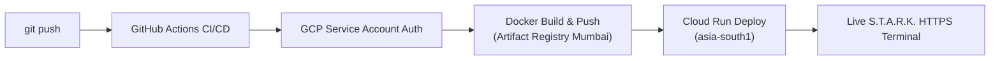

# ⚡ S.T.A.R.K. (Stock Testing, Analytics & Ratio Kernel) [v1.1.0]

<p align="center">
  
</p>

<p align="center">
  <strong>An advanced quantitative financial research engine & telemetry dashboard for fundamental stock analytics, mathematical ratio verification, and automated cloud deployments.</strong>
</p>

<p align="center">
  
  
  
  
  
  
</p>

---

## 📋 Overview

**S.T.A.R.K.** is designed for quantitative analysts, investment researchers, and financial engineers who demand high-fidelity, deterministic computations from AI models with robust privacy controls and automated institutional deployments.

### Key Capabilities:
- **🔒 Security Clearance Gatekeeper**: Terminal access restricted by an encrypted Level 4 security passcode (`APP_PASSWORD`). Unauthorized visitors cannot view telemetry or query LLM endpoints.
- **⚡ Dual Runtime Engine**:
  - **Local Mode**: Autonomous local lifecycle management with **Ollama** and **Qwen 2.5 (7B)**.
  - **Cloud Mode**: High-speed, serverless inference via **Qwen 3.8 (27b)** deployed on **Google Cloud Run**.
- **🎨 Carbon Obsidian UI**: Institutional dark-mode dashboard styled with *Reactor Cyan* glowing accents, live telemetry badges, and real-time token streaming.
- **🐳 Cloud Run Containerization**: Ultra-lightweight Docker container (`python:3.11-slim`) configured for dynamic port binding and zero-cost scale-to-zero compute.
- **🔄 Automated GitHub CI/CD**: Pushing to `main` or feature branches triggers an automated pipeline deploying the application to Google Cloud Run in Mumbai (`asia-south1`).

---

## 🛠️ Architecture

```
STARK/
├── .github/
│   └── workflows/
│       └── deploy.yml          # Automated CI/CD pipeline to Google Cloud Run (Mumbai)
├── assets/
│   └── stark_logo.jpg          # Geometric S-Monogram brand icon
├── src/
│   ├── stark_kernel.py         # Core LLM prompt engine & universal OpenAI client wrapper
│   └── ollama_manager.py       # Hybrid local Ollama manager & cloud endpoint detector
├── app.py                      # Streamlit UI dashboard with Security Gatekeeper
├── requirements.txt            # Production Python package manifest
├── Dockerfile                  # Container definition optimized for Google Cloud Run
├── .dockerignore               # Build boundary preventing secrets/cache leaks
├── .env                        # Local configuration (never committed to Git)
├── .gitignore                  # Git privacy & cache exclusions
└── README.md                   # System documentation
```

---

## ⚡ Local Quickstart

### 1. Prerequisites
- **Python 3.10+** (Python 3.11 recommended)
- **Ollama**: [Download Ollama](https://ollama.com/download)
- Pull the target local model:
  ```powershell
  ollama run qwen2.5:7b
  ```

### 2. Installation
Clone the repository and install required dependencies:
```powershell
git clone https://github.com/dasArko93/STARK.git
cd S_T_A_R_K_v1.1.0
pip install -r requirements.txt
```

### 3. Environment Configuration
Create or configure your local `.env` file:
```env
# Local Ollama endpoint
BASE_URL=http://localhost:11434/v1
API_KEY=ollama
MODEL=qwen2.5:7b

# S.T.A.R.K. Security Gatekeeper Passcode
APP_PASSWORD=stark_admin_!@#
```

### 4. Running Locally
Launch the interactive web UI:
```powershell
streamlit run app.py
```
1. Enter your security passcode at the **S.T.A.R.K. Security Clearance** prompt.
2. Once unlocked, the full quantitative telemetry dashboard is available.

---

## ☁️ Cloud Architecture & CI/CD Deployment

S.T.A.R.K. is engineered for continuous deployment to **Google Cloud Run (Mumbai / `asia-south1`)** via **GitHub Actions**.

### Automated Deployment Pipeline:


### Cloud Environment Secrets (GitHub Encrypted Secrets):
All sensitive credentials remain 100% private and encrypted within GitHub:
- `GCP_PROJECT_ID`: Target Google Cloud Project ID.
- `GCP_SA_KEY`: Service account key JSON for `github-deployer`.
- `GEMINI_API_KEY`: Google AI Studio API key.
- `APP_PASSWORD`: Custom security clearance passcode for the web terminal.

---

## 🧮 Core Capabilities & Ratio Suite

| Category | Supported Metrics & Analytics |
| :--- | :--- |
| **Valuation** | P/E Ratio, P/B Ratio, EV/EBITDA, Discounted Cash Flow (DCF) |
| **Solvency & Health** | Debt-to-Equity, Current Ratio, Quick Ratio, Interest Coverage |
| **Profitability** | Return on Equity (ROE), Return on Invested Capital (ROIC), Gross & Operating Margins |
| **Growth Analytics** | Compound Annual Growth Rate (CAGR), YoY / QoQ Revenue & Earnings Telemetry |

---

## 🛡️ License
Distributed under the MIT License. See `LICENSE` for more information.
