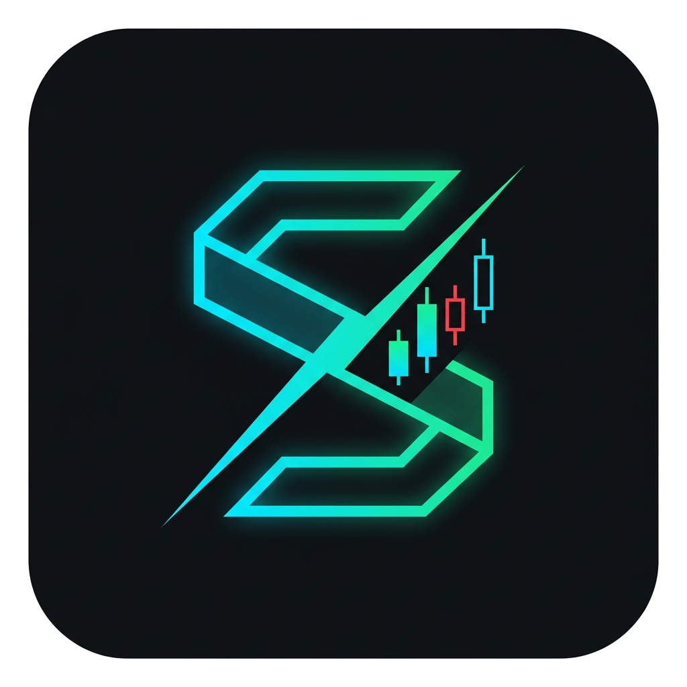

# ⚡ S.T.A.R.K. (Stock Testing, Analytics & Ratio Kernel) [v1.1.0]

<p align="center">
  
</p>

<p align="center">
  <strong>An advanced quantitative financial research engine & telemetry dashboard for fundamental stock analytics, mathematical ratio verification, and financial data synthesis.</strong>
</p>

<p align="center">
  
  
  
  
  
</p>

---

## 📋 Overview

**S.T.A.R.K.** is designed for analysts, quants, and investors who demand high-fidelity, deterministic computations from AI models without cloud dependencies or telemetry leaks. 

Powered by **Qwen 2.5 (7B)** running locally via **Ollama**, S.T.A.R.K. connects through an OpenAI-compatible interface, offering:
- **Autonomous Local LLM Lifecycle**: Automatically detects and launches `ollama serve` in the background when running the application.
- **Provider Agnostic**: Switch seamlessly between local Ollama models and cloud APIs (OpenAI, Groq, etc.) using a simple `.env` config.
- **Streamlit Institutional Interface**: Styled in *Carbon Obsidian* dark-mode with *Reactor Cyan* accents and real-time streaming tokens.
- **Dual Runtime**: Run either through a web GUI or via an interactive CLI terminal console.

---

## 🛠️ Architecture

```
STARK/
├── assets/
│   └── stark_logo.jpg          # Geometric S-Monogram brand icon
├── src/
│   ├── stark_kernel.py         # Core LLM prompt engine & OpenAI client wrapper
│   └── ollama_manager.py       # Auto-discovery & background process manager for Ollama
├── app.py                      # Streamlit Dark UI dashboard
├── .env                        # Provider & model parameters (BASE_URL, MODEL, API_KEY)
├── .gitignore                  # Git privacy & cache exclusions
└── README.md                   # System documentation
```

---

## ⚡ Quickstart

### 1. Prerequisites
- **Python 3.10+**
- **Ollama**: [Download Ollama](https://ollama.com/download)
- Pull the target model:
  ```powershell
  ollama run qwen2.5:7b
  ```

### 2. Installation
Clone the repository and install required dependencies:
```powershell
git clone https://github.com/dasArko93/STARK.git
cd S_T_A_R_K_v1.1.0
pip install streamlit openai python-dotenv
```

### 3. Environment Configuration
Verify or modify `.env` as needed:
```env
BASE_URL=http://localhost:11434/v1
API_KEY=ollama
MODEL=qwen2.5:7b
```

---

## 🚀 Usage

### 🖥️ Streamlit Web Dashboard (Recommended)
Launch the interactive web UI:
```powershell
streamlit run app.py
```
> *S.T.A.R.K. automatically verifies local Ollama connectivity and launches the background server if it's currently offline.*

### ⌨️ Terminal Interactive Console (CLI)
For a lightweight terminal-only session:
```powershell
python src/stark_kernel.py
```

---

## 🧮 Core Capabilities

| Category | Supported Metrics & Analytics |
| :--- | :--- |
| **Valuation** | P/E Ratio, P/B Ratio, EV/EBITDA, Discounted Cash Flow (DCF) |
| **Solvency & Health** | Debt-to-Equity, Current Ratio, Quick Ratio |
| **Profitability** | Return on Equity (ROE), Return on Invested Capital (ROIC), Gross & Operating Margins |
| **Growth Analytics** | Compound Annual Growth Rate (CAGR), YoY / QoQ telemetry |

---

## 🛡️ License
Distributed under the MIT License. See `LICENSE` for more information.
